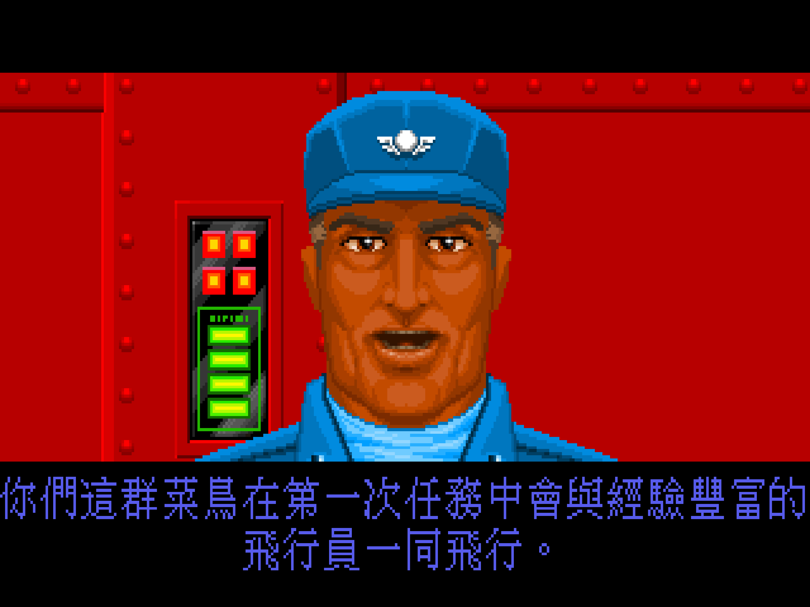
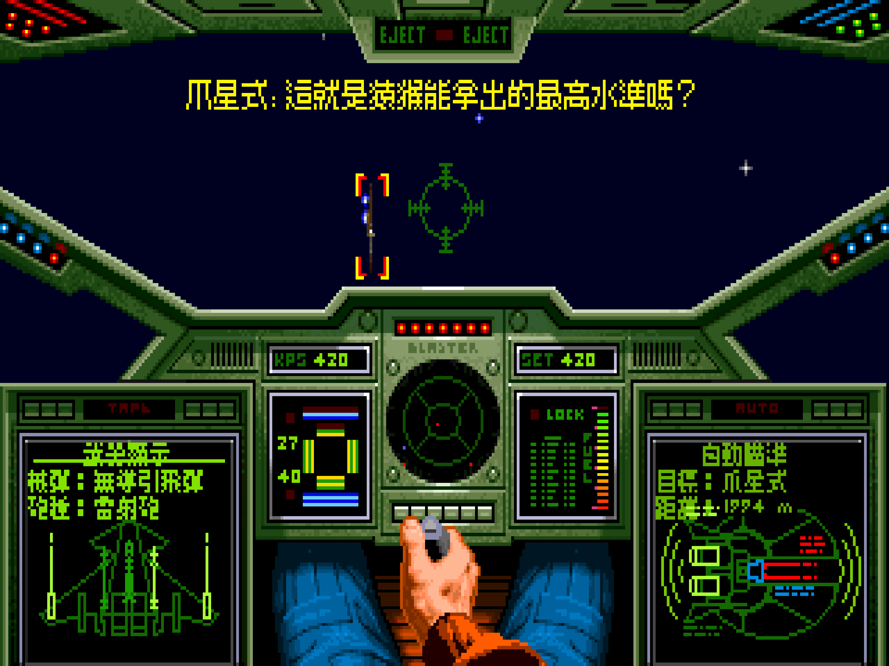
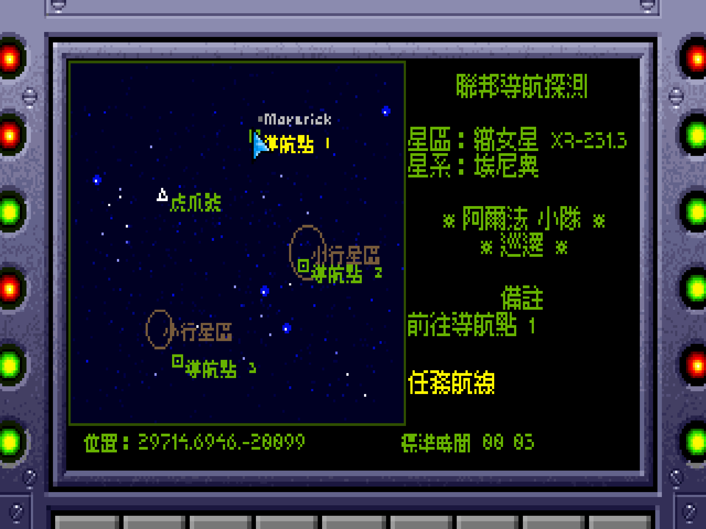
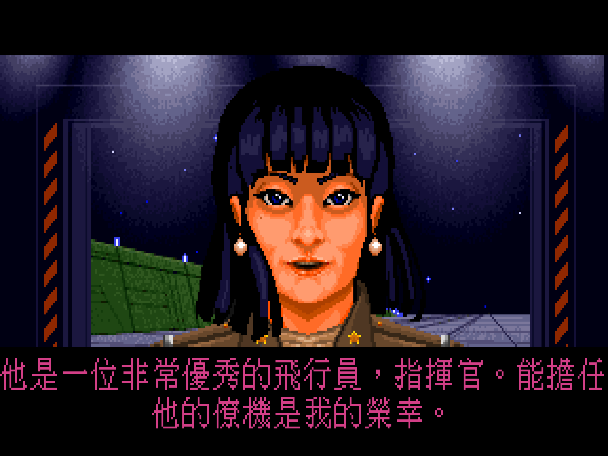
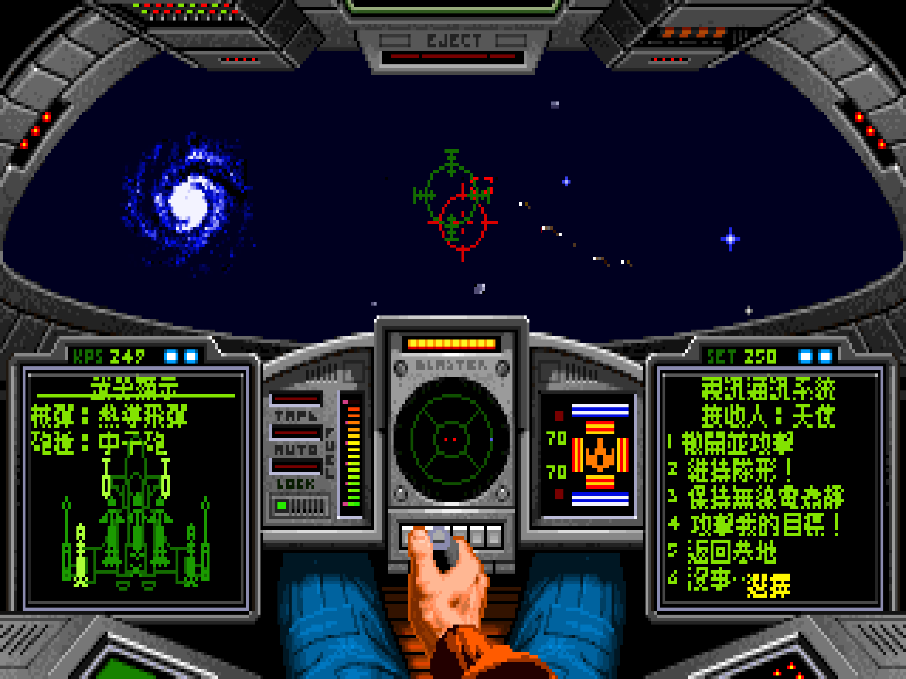
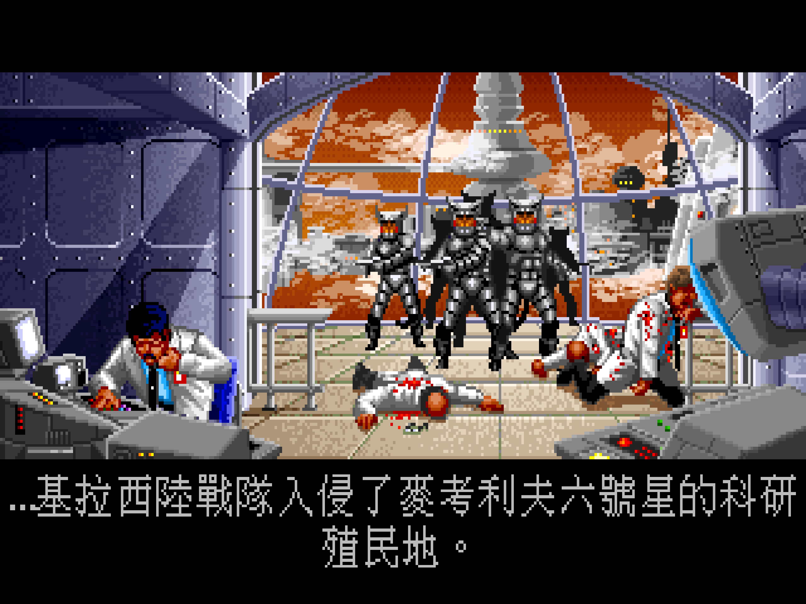
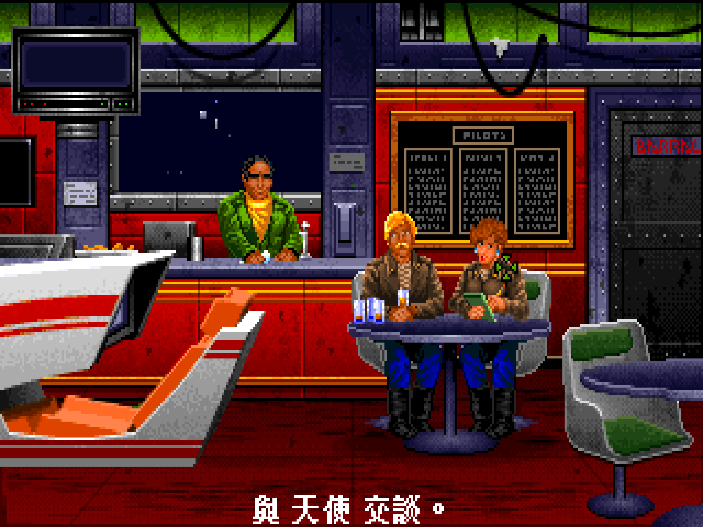
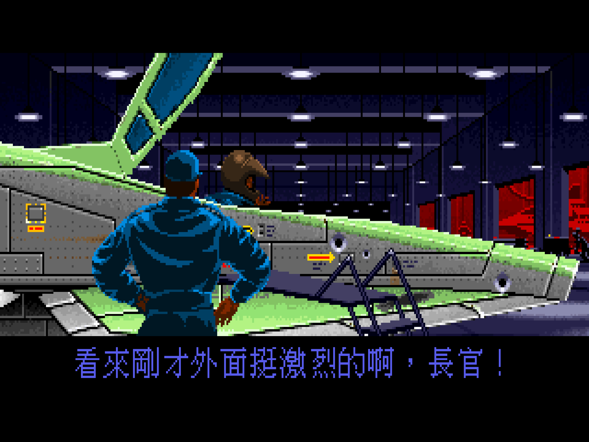

# Wing Commander 銀河飛將正體中文化 (Kilrathi Saga版本)


  
**中文化字幕、資源檔等套件請進入下載頁面** </br>
**https://github.com/lightgreentw/wc1_CHT/releases**

## 概述
本中文化是基於銀河飛將三部曲的 Wing Commander: the Kilrathi Saga (後面簡稱KS) 中 Wing Commander一代Windows 95版本，增加正體中文（台灣）支援，包含：
- 遊戲介面、字幕中文化
- 以對照表方式翻譯不改動遊戲原始程式
- 配合遊戲畫面使用不同大小的中文字型
- 加強因為新電腦過快問題的減速功能
- 中文化支援主遊戲及兩套資料片
- $\color{red}{中文化不含遊戲原始檔}$

---

## 中文化相關檔案
```
wc1_CHT/
├── wc1cht.ini                  設定檔（字型、場景規則等）
├── wc1zh.trs                   主翻譯表
│
├── src/
│   ├── wc1cht.cpp              Hook DLL 主程式（Hook1／Hook2／Hook3、翻譯比對、字型繪製、折行）
│   ├── wc1cht_patch.cpp        Detour 安裝工具（修補 exe）
│   ├── wc1cht_profile.inc      多版本支援：辨識 WC1／SM1／SM2／Transfer，位址換算
│   ├── wc1cht_profile_tables.inc   多版本符號表與區段表（自動產生）
│   ├── wc1cht_ext.inc          選用模組：F12 Debug、F10/F11 調速、Ctrl+F12 傾印
│   ├── wc1cht_speedcfg.inc     選用模組：[Speed] 設定解析
│   ├── wc1cht_probe.inc        選用模組：記憶體觀測器（Ctrl+F10）
│   ├── wc1cht_interp.inc       選用模組：子畫面內插（Ctrl+F11）
│   ├── CMakeLists.txt          CMake 建置檔（MSVC）
│   └── build_msys2.sh          MSYS2 MINGW32 建置腳本
│
├── BDF/                   點陣字型檔
│   ├── boutique7.bdf           精品點陣體7×7
│   ├── boutique9.bdf           精品點陣體9×9
│   ├── nightgazer12b.bdf       夜照飛點陣字型12x12粗體
│   ├── nightgazer15.bdf        夜照飛點陣字型15x15
│   ├── 851tegakizatus15.bdf    851手書き雑フォント15x15
│   └── 851gkktt24.bdf          851電機文字體24x24
│
└── tools/
    ├── bdf_to_czht_fnt.py      BDF 點陣字轉 CZHT .fnt
    ├── inspect_czht_fnt.py     離線檢查 CZHT 字型檔
    ├── wcres.py                原WCDX專案 解包工具python化 
    ├── wcfont.py               原WCDX專案 字型檔解析工具python化
    ├── wc1_extract_text.py     匯出可翻譯文字 TSV
    └── wc1cht_hash_tool.py     翻譯對照檔編譯工具
```

---

## 中文化安裝前必要準備事項
在進行中文化安裝前還有兩件非常重要的事，雖然KS版已經將一代及二代視窗化，但在發行當下光碟並沒有把資料片（祕密任務１和祕密任務２）放入，當時必須到官方的FTP下載，事過境遷現在也只剩Wing Commander CIC這個最大非官方粉絲網站有好好保存相關檔案。還有，畢竟那是支援很久以前的Windows版本，在現代必須進行畫面處理增強，由網友Bekenn開發。所以必須先進行下面兩項資料片補增及強化套件。

1. 安裝銀河飛將一代的資料片，秘密任務1和秘密任務2
  - https://www.wcnews.com/wcpedia/Secret_Missions_for_the_Kilrathi_Saga
2. 安裝DirectX增強修補套件WCDX
  - https://github.com/Bekenn/wcdx/releases

WCDX套件專案強大的功能是強化顯示，改呼叫Direct3D，使遊戲以當下Windows解析度顯示並維持4:3的比例，以及修復在空戰中戰勝時候的音樂反覆一直響的問題。

中文化安裝包裡有準備安裝批次檔，請將上述兩個資料片補增及強化套件的壓縮檔下載後放到遊戲目錄下，再執行安裝批次檔(或是自行各別在命令列下安裝附件及強化套件。)
  ```console
  install_sm12_wcdx.bat
  ```

---

## 進行中文化安裝
$\color{red}{※中文化完全依據資料片補增及強化套件開發，務必經過前述強化套件安裝}$</br>

請依照以下步驟進行中文化：
- 下載中文化安裝包 https://github.com/lightgreentw/wc1_CHT/releases
- 解壓縮中文化安裝包，並把所有檔案都放到遊戲資料夾下
- 執行安裝批次檔 
  ```console
  install_wc1cht.bat  
  ```
- 或是在命令列將主遊戲、秘密任務等執行檔各別執行 wc1cht_patch.exe
  ```console
  wc1cht_patch wing1_wcdx.exe
  wc1cht_patch sm1_wcdx.exe
  wc1cht_patch sm2_wcdx.exe
  wc1cht_patch transfer_wcdx.exe
  ```
- 安裝完成後即可直接執行遊戲，各別執行檔案如下
  - 銀河飛將主戰役  `wing1_wcdx_cht.exe`
  - 銀河飛將 - 祕密任務1  `sm1_wcdx_cht.exe`
  - 銀河飛將 - 祕密任務2  `sm2_wcdx_cht.exe`
  - 祕密任務傳送人物程式  `transfer_wcdx_cht.exe`

---

## 遊戲中文化畫面
<table>
  <tr>
    <td align="center">
      <a href="./WC1CHT_001.png">
        
      </a>
    </td>
    <td align="center">
      <a href="./WC1CHT_002.png">
        
      </a>
    </td>
  </tr>
  <tr>
    <td align="center">
      <a href="./WC1CHT_003.png">
        
      </a>
    </td>
    <td align="center">
      <a href="./WC1CHT_004.png">
        
      </a>
    </td>
  </tr>
  <tr>
    <td align="center">
      <a href="./WC1CHT_005.png">
        
      </a>
    </td>
    <td align="center">
      <a href="./WC1CHT_006.png">
        
      </a>
    </td>
  </tr>
  <tr>
    <td align="center">
      <a href="./WC1CHT_007.png">
        
      </a>
    </td>
    <td align="center">
      <a href="./WC1CHT_008.png">
        
      </a>
    </td>
  </tr>
</table>

---

## 額外功能
除中文化外，本專案增加兩個可以快速引用的功能，在ini檔裡可以設定
1. Debug Mode
  俗稱作弊模式，在ini中開啟標籤，即可使用[F12]開啟/關閉。
  ```
  [Debug]
  Enable=1 ;預設開啟
  ToggleKey=F12 ;預設按鍵，可以自訂
  ```
  - 開啟和關閉都會有提示音
  - 開啟後自機可以無敵
  - [ALT]+[Del]摧毀瞄準的敵機
  - [ALT]+[Ins]摧毀所有敵機
  - 要注意開啟此模式，遊戲會產生標記，玩家名字會變成[CHEATER]，記得存檔前要關掉

2. 降速
  KS原版本可以按[ALT]+[N]或[ALT]+[M]透過調整FPS來升降遊戲速度，但只有在空戰有作用，本專案加強功能，在ini中開啟標籤，可以透過[F10]和[F11]來調整速度。
  ```
  [Speed]
  Enable=1 ;預設開啟
  MHzSteps=16,20,25,33,40,50,66,80 ;以CPU時脈命名檔數
  CpuMHz=33 ;預設起始時脈
  SlowerKey=F10 ;預設降速按鈕
  FasterKey=F11 ;預設升速按鈕
  OtherFps=11  ;除空戰場景外其他場景也降速
  ```
  - 改用CPU時脈的方式設定可以淺顯易懂。
  - 開啟功能時會關閉[ALT]+[N]及[ALT]+[M]功能
  - 除空戰場景外，其他介面及過場動畫都可控制降速
  - 更能符合90年代當年的速度
---

## 名詞翻譯對照
### 1. 種族／勢力

| 英文 | 中文 | 備註 |
|---|---|---|
| Terran / Terrans | 地球人 | 人類（形容詞／複數） |
| Confederation | 地球聯邦 | Terran Confederation |
| Confed / Confederate | 聯邦 | 縮寫／形容詞 |
| Firekka | 費雷卡 | 心宿二星系的 Firekka 人，友善中立 |
| Kilrathi | 基拉西人 | 敵方貓族 |
| Empire of Kilrah | 基拉西帝國 | Kilrathi Empire |

### 2. 地名
| 英文 | 中文 | 備註 |
|---|---|---|
| Terra | 地球 | 母星 |
| Vega | 織女 | Vega Sector |
| Antares | 心宿二 | Antares Sector |
| Deneb | 天津四 | Deneb Sector |
| Enyo | 埃尼奧 | 開場簡報室星系 |
| Hubble's | 哈伯 | Hubble's Star System |
| Planck's | 普朗克 | Planck's Star（聯邦失去的星系） |
| Venice | 凡尼斯 | |
| Corsair | 科賽爾 | |
| Brimstone | 布林斯通 | |
| Gimle | 津利 | |
| Gateway | 蓋威 | |
| Kurasawa | 黑澤 | |
| Port Hedland | 黑德蘭港 | |
| Chengdu | 成都 | |
| Dakota | 達科他 | |
| Charon | 卡戎 | |
| Valgard | 瓦爾加德 | |
| Rostov | 羅斯托夫 | |
| Ymir | 尤彌爾 | |
| McAuliffe | 麥考利夫 | |
| Goddard | 戈達德 | Goddard Colony |
| Hell's Kitchen | 地獄廚房 | 難民／平民殖民地 |
| Epsilon Station | 葉普西隆太空站 | |
| Terran Research Colony | 地球聯邦科學考察站 | |
| Vega Nine | 織女星九號 | 被毀的殖民地 |

### 3. 艦船
| 英文 | 中文 | 陣營 | 備註 |
|---|---|---|---|
| Tiger's Claw | 虎爪號 | 我方 | 主艦 |
| Austin | 奧斯汀號 | 我方 |  |
| General Powell / Powell | 鮑威爾將軍號／鮑威爾號 | 我方 | 曾被俘獲 |
| Perez de Cuellar | 德奎利亞爾號 | 我方 |  |
| Marciano | 馬西亞諾號 | 我方 | Venture 級護衛艦 |
| Johann | 約翰號 | 我方 | |
| Exeter | 艾希特級 | 我方 | 驅逐艦級別，亦為艦名 |
| Trygvie Lie | 賴伊號 | 我方 | |
| Tsiolkovsky | 齊奧卡夫斯基號 | 我方 | 研究船 |
| Winterrowd | 溫特勞德號 | 我方 | |
| Jerusalem | 耶路撒冷號 | 我方 | |
| Formidable | 嚴陣號 | 我方 | Della Guardia 指揮 |
| Gwenhyvar | 格溫威華號 | 我方 | 傳說艦名 |
| Rapier | 銳劍式 | 我方 | 新型戰機 |
| Scimitar | 彎刀式 | 我方 | 中型戰機 |
| Raptor | 猛禽式 | 我方 | 重型戰機 |
| Hornet | 大黃蜂式 | 我方 | 輕型戰機 |
| Dralthi | 爪星式 | 我方 | 輕型戰機 |
| Venture | 曼徹級 | 我方 | 護衛艦級別 |
| Dilligent | 勤勉級 | 我方 | 救援運輸艦 |
| Drayman | 德雷曼級 | 我方 | 運輸艦 |
| Krant | 鬼焰式 | 敵方 | 中型戰機 |
| Salthi | 煞星式 | 敵方 | 中型戰機 |
| Gratha | 格殺式 | 敵方 | 重型戰機 |
| Jalthi | 角星式 | 敵方 | 重型戰機 |
| Hhriss | 赫里斯式 | 敵方 | 新型戰機 |
| Fralthi | 弗拉斯級 | 敵方 | 巡洋艦 |
| Snakeir | 史奈克級 | 敵方 | 航艦 |
| Dorkir | 多爾克級 | 敵方 | 主力艦 |
| Ralari | 拉歐里級 | 敵方 | 護衛／巡防艦 |
| Lumbari | 倫巴里級 | 敵方 | 補給艦 |
| Sivar | 西瓦號 | 敵方 | Lord Sivar 及以其命名的目標 |

### 4. 部隊／小隊
| 英文 | 中文 | 備註 |
|---|---|---|
| Alpha Wing / Alpha | 阿爾法小隊／阿爾法 | 希臘字母讀音參考([維基百科](https://zh.wikipedia.org/zh-tw/%E5%B8%8C%E8%85%8A%E5%AD%97%E6%AF%8D)) |
| Beta Wing / Beta | 貝塔小隊／貝塔 | |
| Gamma Wing / Gamma | 伽馬小隊／伽馬 |  |
| Delta Wing / Delta | 德爾塔小隊／德爾塔 |  |
| Epsilon Wing / Epsilon | 艾普西隆小隊／艾普西隆 | |
| Zeta Wing / Zeta | 澤塔小隊/澤塔 | |
| Eta Wing / Eta | 伊塔小隊/伊塔 | |
| Theta Wing / Theta | 西塔小隊／西塔 | |
| Iota / Kappa / Lambda | 約塔/卡帕/拉姆達（各加「小隊」） | |
| Mu / Nu / Xi / Omicron | 謬/紐/克西/奧米克戎（各加「小隊」）  | |
| Rho / Sigma / Tau / Upsilon | 柔/西格馬/陶/宇普西隆（各加「小隊」） | |
| Phi / Chi / Psi / Omega | 斐/希/普塞/奧米伽（各加「小隊」） | |
| Killer Bees | 殺人蜂中隊 | |
| Blue Devil(s) | 藍魔鬼中隊 | 詞彙表為單數 |
| Black Lion | 黑獅中隊 | |
| Reavers | 掠奪者中隊 | |
| Hornets / Raptors / Rapiers | 大黃蜂中隊／猛禽中隊／銳劍中隊 | 與機型同名的複數形 |
| Marines | 陸戰隊 | |
| Company Zebra | Z連 | 陸戰隊 | |
| Imperial Guard | 帝國親衛隊 | 基拉西皇家衛隊 | |

### 5. 人物

**飛行員（呼號與本名）**
| 呼號 | 中文呼號 | 本名 | 中文本名 | 階級 |
|---|---|---|---|---|
| Spirit | 幽靈 | Mariko Tanaka | 田中真理子 | 中尉 |
| Hunter | 獵人 | Ian St. John | 伊恩．聖約翰 | 上尉 |
| Bossman | 老總 | Kien Chen | 陳建 | 少校 |
| Iceman | 冰人 | Michael Casey | 麥可．凱西 | 少校 |
| Angel | 天使 | Jeannette Devereaux | 珍妮特．德弗洛 | 上尉 |
| Paladin | 遊俠 | James Taggart | 詹姆斯．泰格特 | 少校 |
| Maniac | 狂人 | Todd Marshall | 陶德．馬歇爾 | 中尉 |
| Knight | 騎士 | Joseph Khumalo | 約瑟夫．庫馬洛 | 上尉 |
| Doomsday | 末日 | Etienne Montclair | 艾蒂安．蒙克萊 | 中尉 |
| Jazz | 爵士 | Zach Colson | 札克．科爾森 | 中尉 |

**其他人物**
| 英文 | 中文 | 備註 |
|---|---|---|
| Shotglass | 烈酒杯 | 酒吧酒保 |
| Sam | 山姆 | 酒吧人物 |
| Halcyon | 海爾西恩 | 上校，基地指揮官 |
| Kristi Marks | 克莉絲蒂．馬克斯 | 少校，Company Zebra |
| Baker | 貝克 | 少校，Vega Sector |
| Roberts | 羅伯茨 | 上校 |
| Zaritsky | 札里茨基 | 上校 |
| Della Guardia | 德拉．瓜迪亞 | 指揮官，Formidable |
| Khalsa | 卡爾薩 | 博士 |
| Larrhi | 拉里 | 上尉，Firekka 人 |

**敵方人物**
| 英文 | 中文 | 稱號 | 中文稱號 | 身分 |
|---|---|---|---|---|
| Lord Sivar | 西瓦主神 | | | 神 |
| Thrakhath | 斯拉克薩斯 | | | 皇子 |
| Ralgha | 拉爾加 | | | 艦長 |
| Bakhtosh | 巴塔許 | Redclaw | 紅爪 | 男爵，王牌 |
| Khajja | 卡賈 | the Fang | 獠牙 | 王牌 |
| Bhurak | 布拉克 | Starkiller | 弒星者 | 王牌 |
| Dakhath | 達卡斯 | the Deathstroke | 絕殺 | 王牌 |
| Kharang | 卡朗 | | | 空戰通訊中出現 |

### 6. 軍階／頭銜
| 英文 | 中文 |
|---|---|
| Admiral | 上將 |
| General | 將軍 |
| Colonel | 上校 |
| LT. COL. | 中校 |
| Major | 少校 |
| Captain | 上尉 |
| Lieutenant / 1ST LT. | 中尉 |
| 2ND LT. | 少尉 |
| Commander | 指揮官 |
| Prince | 皇子 |
| Baron | 男爵 |
| Lord | 神 |

---

## 建置

需要 32 位元工具鏈。
MSYS2（「MSYS2 MINGW32」shell）：
```bush
pacman -S mingw-w64-i686-gcc make
./build_msys2.sh
```
或使用 CMake：
```bush
cmake -A Win32 -B build
cmake --build build --config Release
```

---

## 已知問題
1. 部分翻譯仍然維持英文有兩種原因，一種是對照表沒有擷取到，另一種是字數有誤
2. ini中關於調整速度的部分仍在測試中，可以透過參數開關

---

## Acknowledgements
- Origin Systems 開發 Wing Commander 並移植 Kilrathi Saga 版本
- Electronic Arts 發行 Wing Commander: The Kilrathi Saga
- [WCDX 專案](https://github.com/Bekenn/wcdx) 在影像的提升備受尊崇，讓 the Kilrathi Saga 版本更有價值
- [wc1-re 專案](https://github.com/neuromancer/wc1-re) 重建的核心對本專案有參考的依據
- [精品點陣體9×9](https://github.com/scott0107000/BoutiqueBitmap9x9) 作者:Luke036  
- [精品點陣體7×7](https://github.com/scott0107000/BoutiqueBitmap7x7) 作者:Luke036 
- [夜照飛點陣字型12x12粗體及15x15](https://github.com/scott0107000/Nightgazer-Bitmap) 作者:Luke036 
- [851手書き雑フォント](https://pm85122.onamae.jp/851fontpage.html) 作者:8:51:22 pm 
- [851ゴチカクット](https://pm85122.onamae.jp/851Gkktt.html) 作者:8:51:22 pm 

---

## License
詳見 [LICENSE](https://github.com/lightgreentw/wc1_CHT/tree/main?tab=GPL-3.0-1-ov-file)，開發過程使用Anthropic Claude。
字型檔不在前述授權範圍內，請依各自的條款使用。
本專案為非遊戲官方的粉絲專案。

---
